# Rindi-Agent User Guide

This guide covers Rindi-Agent 0.9.0 beta. Every screenshot comes from a real session on a small example project, `todo-cli`.

- [1. Install and set up a model](#1-install-and-set-up-a-model)
- [2. Workspaces and sessions](#2-workspaces-and-sessions)
- [3. Working with the agent](#3-working-with-the-agent)
- [4. Permission modes and approvals](#4-permission-modes-and-approvals)
- [5. The side panels](#5-the-side-panels)
- [6. Computer Use](#6-computer-use)
- [7. Settings](#7-settings)
- [8. Instructions, skills and MCP servers](#8-instructions-skills-and-mcp-servers)
- [9. Keyboard shortcuts and slash commands](#9-keyboard-shortcuts-and-slash-commands)
- [10. Where your data lives](#10-where-your-data-lives)
- [11. Troubleshooting](#11-troubleshooting)

---

## 1. Install and set up a model

### Install the app

1. Download `Rindi-Agent-0.9.0.dmg` from the [releases page](https://github.com/True2456/Rindi-Agent-releases/releases).
2. Open the disk image and drag **Rindi-Agent** onto the **Applications** shortcut.
3. Eject the disk image and open Rindi-Agent from Applications.

Rindi-Agent is signed and notarized by Apple. The first time you open it, macOS asks whether to open an app downloaded from the internet. Choose **Open**.

### Choose a model

On first launch, **Set up a model** opens.

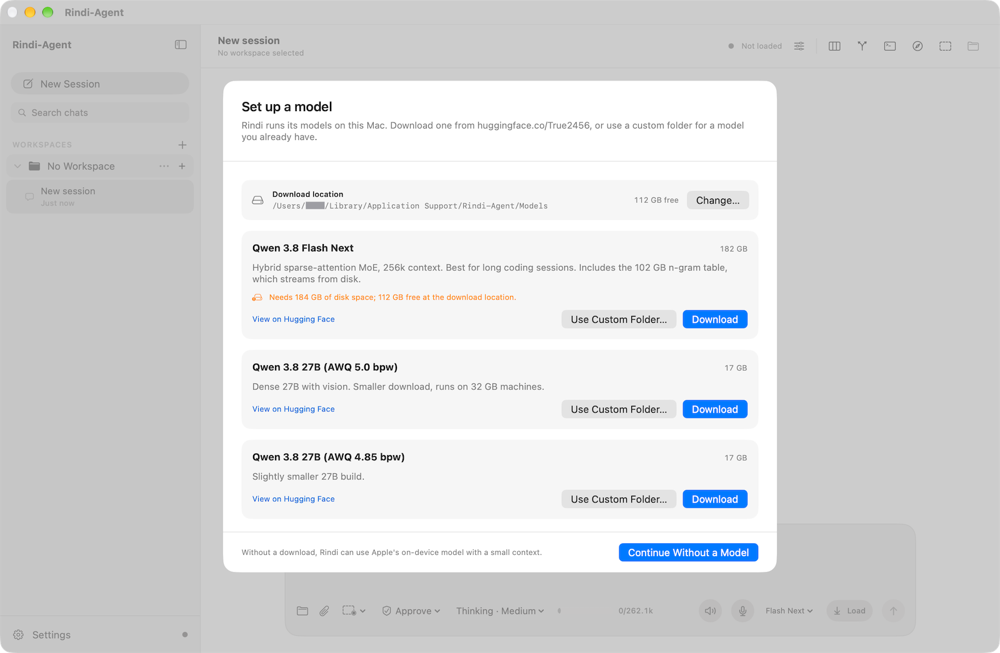

| Model | Download | Unified memory | Choose it when |
| --- | --- | --- | --- |
| Qwen 3.8 Flash Next | 182 GB | 128 GB | You have 128 GB or more and want long sessions (up to 256k tokens) |
| Qwen 3.8 27B (AWQ 5.0 bpw) | 17 GB | 32 GB | You have 32–96 GB, or want images and video in prompts |
| Qwen 3.8 27B (AWQ 4.85 bpw) | 17 GB | 32 GB | You want a slightly smaller 27B |

- **Download** fetches the model from Hugging Face into the **Download location** shown at the top. Use **Change…** to put models on another drive. A download resumes after an interruption, every file is checked against its published checksum, and the model only counts as installed once the whole download is complete.
- The window checks free space first. In the screenshot, the Mac has 112 GB free, so Flash Next (which needs 184 GB) shows a warning.
- **Use Custom Folder…** points Rindi-Agent at a copy of the model you already have.
- **Continue Without a Model** uses Apple's on-device model, which is good for short questions but has a small context.

You can come back to this window at any time from **Settings › Models › Model Setup…** or the **Help** menu.

> **Tip:** Flash Next loads about 70 GB into memory for the first reply, which takes a little while. After that the model stays loaded until you unload it or quit.

---

## 2. Workspaces and sessions

A **workspace** is a project folder. Each workspace keeps its own list of **sessions** (chats).

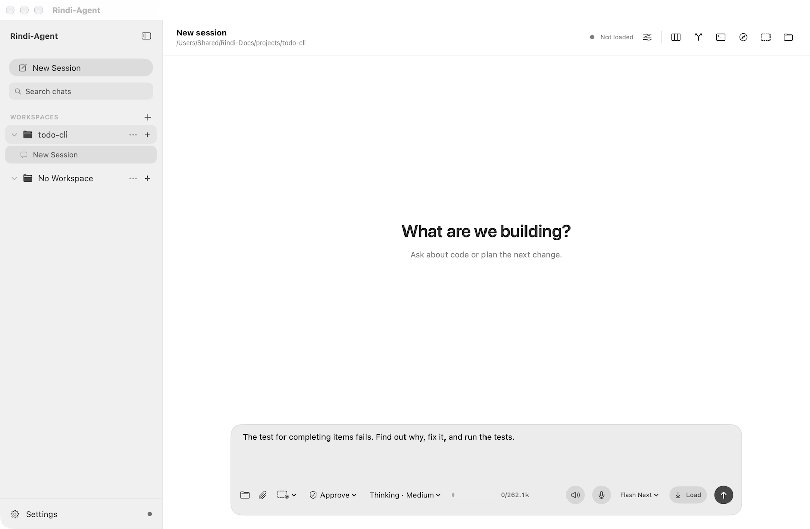

- **Add a workspace:** choose **File › Open Workspace** (⌘O), click **+** next to *Workspaces*, or drop a folder onto the sidebar.
- **Start a session:** choose **New Session** (⌘N), or click **+** on a workspace row.
- **No Workspace** holds chats that aren't about a project. The agent can't touch files from there.
- **Search chats** (⇧⌘F) searches titles and the text of every chat.
- Right-click a session to rename it, copy or export it as Markdown, archive it, or delete it. Archived chats can be restored. Use **⋯** on a workspace row to rename it, reveal it in Finder, open it in Terminal, copy its path, archive all its chats, or remove it from the sidebar. Removing a workspace never deletes the folder.
- If you move a project folder, its workspace is flagged so you can point it at the new location. Its chats are kept.

---

## 3. Working with the agent

### The composer

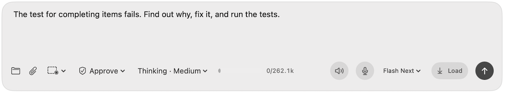

From left to right along the bottom of the composer:

| Control | What it does |
| --- | --- |
| Folder | Add a workspace |
| Paper clip | Attach files, images or video (you can also drag them in) |
| Dashed rectangle | Computer Use options (see [section 6](#6-computer-use)) |
| **Approve** | The agent mode: **Plan**, **Approve** or **Turbo** (see [section 4](#4-permission-modes-and-approvals)) |
| **Thinking · Medium** | How long the model thinks before answering: Low, Medium or XHigh. Shift-Tab cycles it. |
| Bar and `0/262.1k` | How much of the model's context the conversation uses |
| Speaker | Read replies aloud |
| Microphone | Dictate with on-device speech recognition |
| **Flash Next** | The model for the next message |
| **Load** / **Unload** | Load the model ahead of time, or free its memory |
| Arrow | Send (Return). Shift-Return adds a new line. **Stop** (⌘.) replaces it while the agent works. |

Type `/` for commands and `@` for skills. Both open a suggestion list.

### What a turn looks like

Describe the outcome you want. The agent reads the code, runs what it needs, makes the change and checks it:

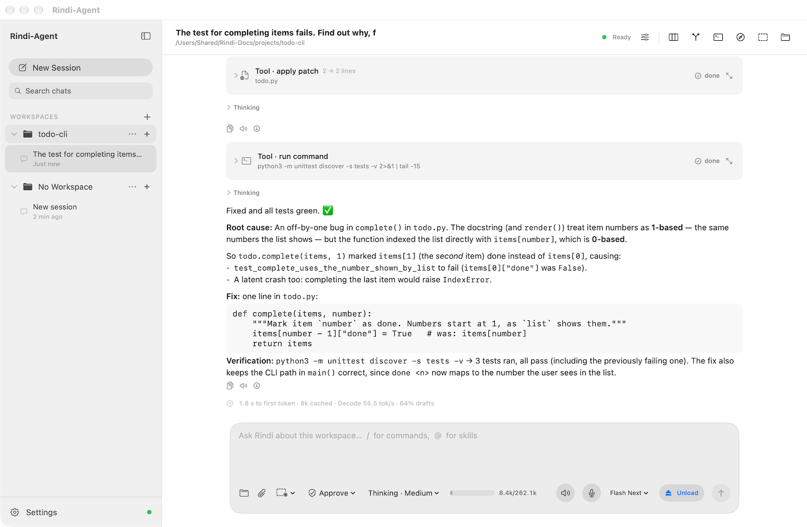

- **Tool cards** (*Tool · read file*, *Tool · run command*, *Tool · apply patch*) show each step and whether it is *done*, *waiting* or *failed*. Click one to see its arguments and output. The arrow on the right opens it in a larger view.
- **Thinking** sections hold the model's reasoning. They are collapsed by default; you can hide them entirely in **Settings › General**.
- The line under the reply shows the time to the first token, how much of the prompt came from cache, decode speed, and how many speculative drafts were accepted.
- The buttons beside each message copy it, read it aloud, or retry it. The pencil on your own message edits and resends it, and **⋯ › Branch from Here** starts a new chat from that point.

You can switch sessions or workspaces while the agent works. When a reply finishes in the background, Rindi-Agent sends a notification.

---

## 4. Permission modes and approvals

The agent mode, chosen in the composer, sets how much the agent may do on its own:

| Mode | Reading and searching | Editing files and running commands |
| --- | --- | --- |
| **Plan** | Allowed | Blocked: the agent investigates and proposes |
| **Approve** (default) | Allowed | Each one waits for you |
| **Turbo** | Allowed | Allowed inside the workspace, without asking |

In **Approve** mode, each command and each file edit shows an **Approval required** card. For a command, the card shows the exact command line:

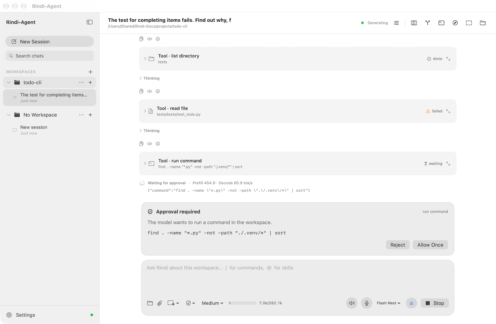

For an edit, the proposed change appears just above the card:

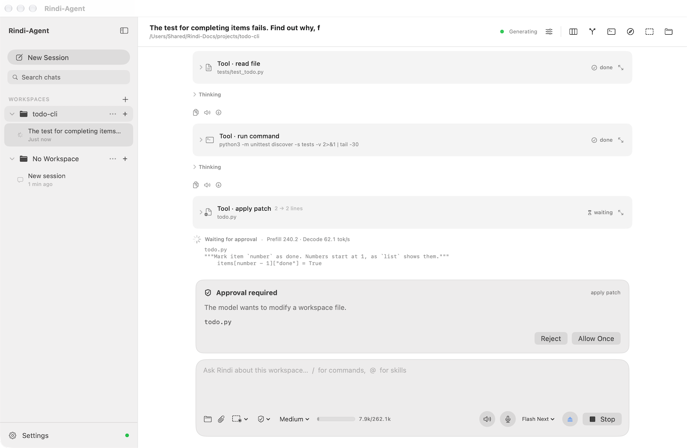

- **Allow Once** runs that one action. The next one asks again.
- **Reject** refuses it. The agent is told and can try another approach.

Commands run in a sandbox that, by default, can write only inside the workspace. **Settings › Tools & Permissions** sets the sandbox, the approval policy and the tools the model can use independently of the mode (see [section 7](#7-settings)).

---

## 5. The side panels

The buttons at the top right of the window open panels beside the chat. The ⌥⌘ shortcuts are listed in [section 9](#9-keyboard-shortcuts-and-slash-commands).

### Source Control

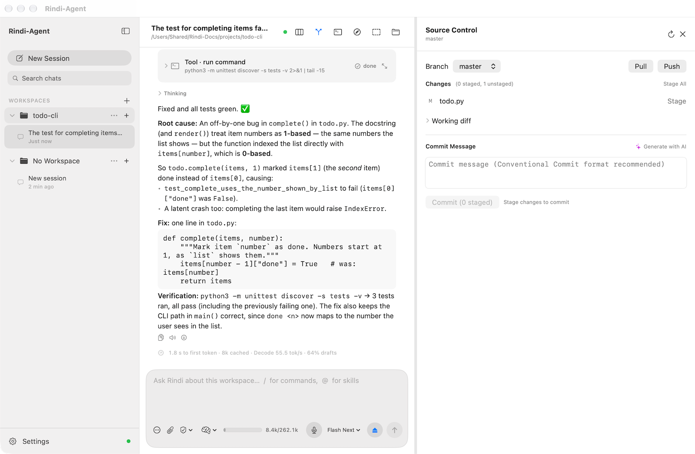

Shows the branch, changed files and the working diff. Stage files one by one or with **Stage All**, write a message or click **Generate with AI** (written by Apple's on-device model), and **Commit**. Switch branches from the **Branch** menu, and **Pull** or **Push** to the remote.

### Files

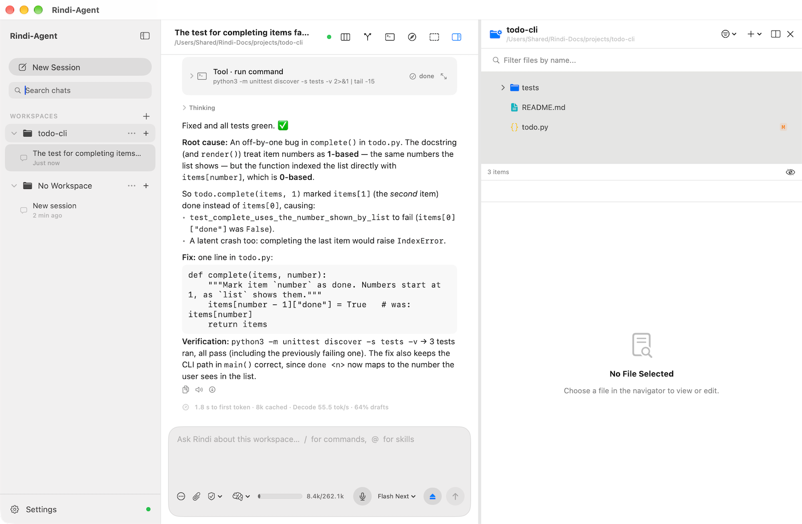

Browse the workspace, filter by name, and open a file to view or edit it. Files changed since the last commit are marked **M**. The eye icon at the bottom shows or hides hidden files.

### Terminal

A terminal for your own commands in the workspace folder. Commands run with the same sandbox and timeout as the agent's (set in **Settings › Tools & Permissions**). ↑ and ↓ recall earlier commands.

Long-running processes the agent starts, such as a development server or a test watcher, appear above the composer with their live output and a stop button.

### Browser

An isolated web browser that the agent can drive for web development and research, and that you can use yourself. **Detach** moves it to its own window. It shares no cookies or sign-ins with Safari or your other browsers.

### Board

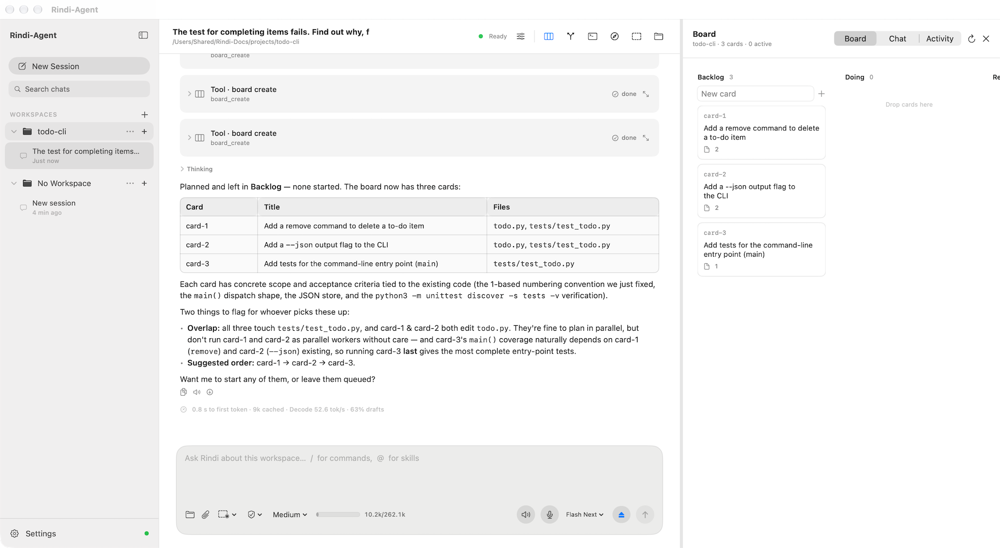

Each workspace has a task board with **Backlog**, **Doing**, **Review**, **Done** and **Blocked** columns. You or the agent can add cards. When you ask it to work on the cards, the agent can hand them to **worker agents**, sub-agents that run in parallel on the same model. Each worker has its own session, shown under the main one in the sidebar. The **Chat** and **Activity** tabs show messages between the agents and what each one did.

**Settings › General › Parallel workers** sets how many workers run at once.

---

## 6. Computer Use

Computer Use lets the agent work with the Mac apps on your screen. It reads an app's window through macOS Accessibility, and it can click, type, choose menu items and press keys there. **It works with the app in the background: your cursor doesn't move and the app you're using keeps focus**, so you can keep working while the agent does.

### Turn it on

Computer Use has two levels:

1. **Observation**: the agent can list windows and read what's in them. This is on by default. The dashed-rectangle menu in the composer turns it off (**Turn Off Computer Use**) and back on (**Enable Computer Use**).
2. **Control**: the agent can also click and type. Turn on **Settings › Tools & Permissions › Native app control**. It's off by default.

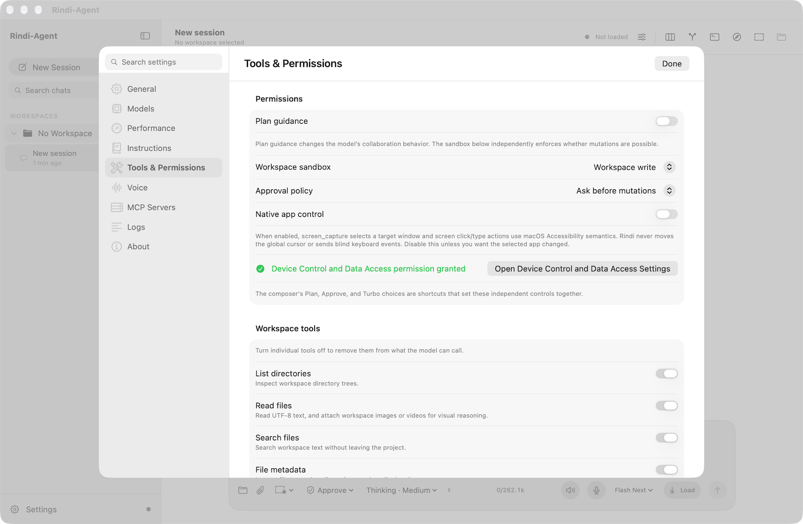

### Grant the macOS permissions

macOS asks for Screen Recording the first time the agent looks at a window. Device Control and Data Access you turn on yourself: click **Open Device Control and Data Access Settings** in **Settings › Tools & Permissions** and enable Rindi-Agent. Both permissions are in **System Settings › Privacy & Security**:

| Permission | For | Turn on |
| --- | --- | --- |
| **Device Control and Data Access** (called *Accessibility* on earlier macOS) | Reading controls, clicking and typing | **Rindi-Agent** |
| **Screen Recording** | Window lists and screenshots for apps that draw their own interface | **Rindi-Agent** |

**Settings › Tools & Permissions** shows whether control access has been granted and has a button that opens the right page of System Settings.

Rindi-Agent includes a small helper app, **Rindi Computer Use**, that captures the screen. If Rindi-Agent itself doesn't have Screen Recording permission, macOS may list the helper in **Screen Recording** too. When that happens, the Computer Use window shows **Open Screen Recording Settings** and **Reveal Rindi Computer Use**. The second button shows the helper inside the app in Finder, where you can drag it into the Screen Recording list.

### Use it

Ask for what you want and name the app:

> Use Computer Use to work out 37 × 48 in Calculator, then tell me the result.

The **Computer Use** window opens on its own and stays on top. It shows the app and window the agent is working in, a live picture of that window with a virtual cursor where the agent acts, and the agent's last action. Use the menu under the title to switch windows. Close it any time; reopen it with the dashed-rectangle button at the top right of the main window.

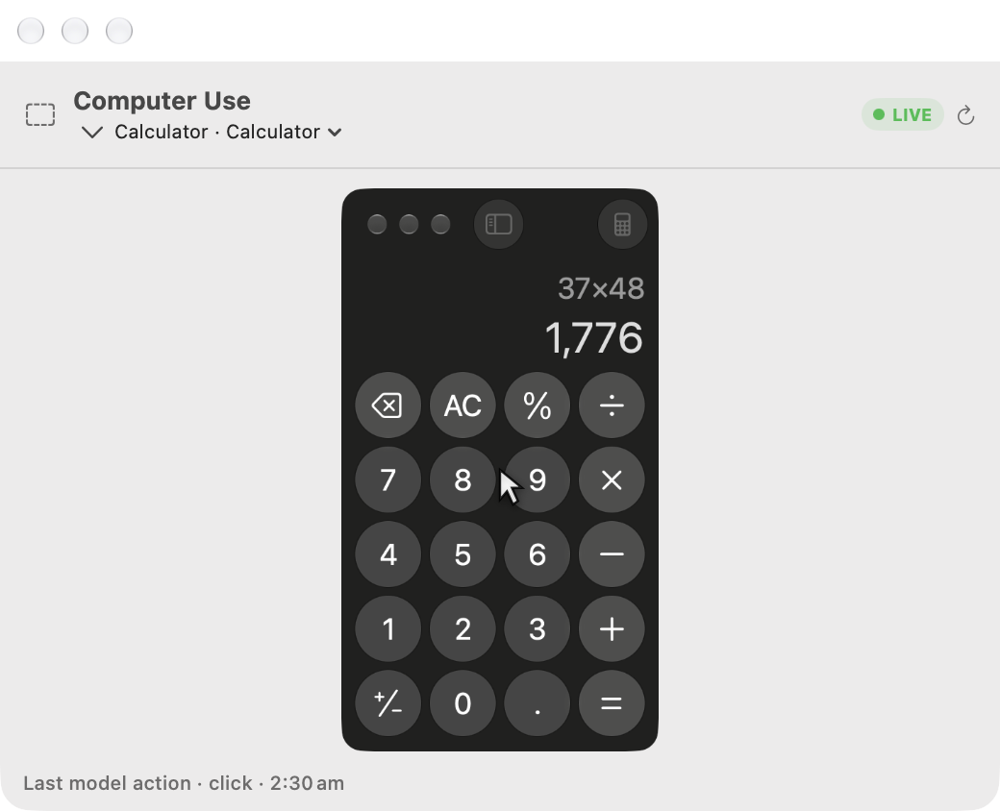

While the agent controls an app, a small bar at the top of the screen names the app. **Stop** ends the agent's control at once:


In the chat, each action is a tool card, and the agent reports what it did and what it read back from the app:

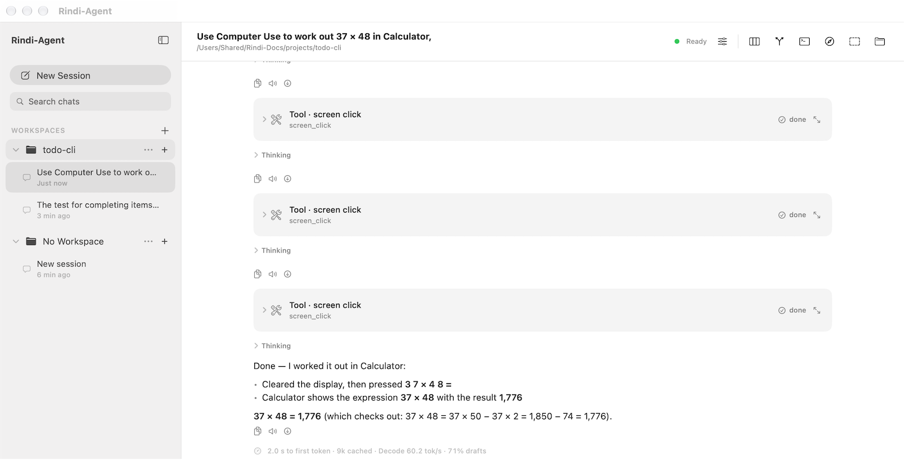

In Approve mode this task took seven approvals, one for each button press. Use Turbo mode for longer tasks in apps you trust. The agent still stops to ask before anything with consequences outside the app.

### What it will and won't do

- Every click, keystroke and text entry follows your agent mode. In **Approve** mode each one waits for **Allow Once**.
- Before anything with consequences outside the app (deleting, sending or posting, buying, accepting terms, changing system settings, entering personal data), the agent is instructed to stop and ask you, even in Turbo mode.
- It never types passwords or payment details. It asks you to.
- Text on screen is treated as information, never as instructions.
- It works best with standard Mac apps. For apps that draw their own interface, such as Ableton Live or Blender, it falls back to screenshots and clicks by position. Those bring the app forward for a moment.

---

## 7. Settings

Open **Settings** with ⌘, or the button at the bottom of the sidebar. Use the search field to find any setting by name. Changes apply immediately.

| Page | What's there |
| --- | --- |
| **General** | Default thinking effort, showing reasoning, background notifications, appearance, and how many worker agents run in parallel |
| **Models** | Each model's folder, context length, maximum output, and speed options; **Model Setup…** |
| **Performance** | Automatic compaction of long chats, how many recent conversations stay in memory, the SSD conversation cache, and the GPU buffer pool |
| **Instructions** | Your global instructions file and installed skills |
| **Tools & Permissions** | Plan guidance, the workspace sandbox, the approval policy, Native app control, each tool on or off, and execution limits |
| **Voice** | Reading replies aloud: voice, rate and volume |
| **MCP Servers** | Model Context Protocol servers |
| **Logs** | The runtime log, with **Copy**, **Show Log File** and **Clear** |
| **About** | Version, memory, data folder, runtime log, and **Reset…** |

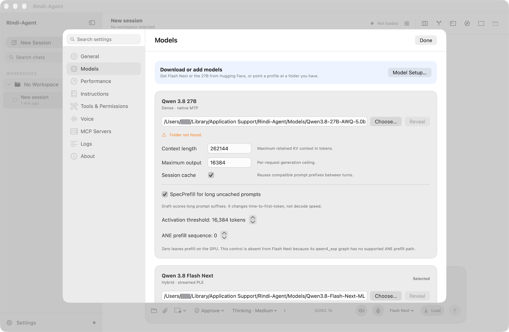

**About › Reset…** returns every setting to its default. Models, chats and workspaces are kept.

---

## 8. Instructions, skills and MCP servers

### Global instructions

`~/.rindi/AGENTS.md` applies to every workspace: your preferred style, tools, or anything else the agent should always know. Edit it in **Settings › Instructions**, or in any editor. Files in your repositories such as `AGENTS.md` or `CLAUDE.md` aren't loaded automatically; the agent reads them when a task calls for it.

### Skills

A skill is a saved procedure in `~/.rindi/skills/<name>/SKILL.md`. Only each skill's name and description go into the prompt; the agent loads the full text when it needs it. Type `@` and a skill's name to attach it to a message. `/skills` lists your skills and opens the folder. The agent can also write and retire skills, with your approval.

### MCP servers

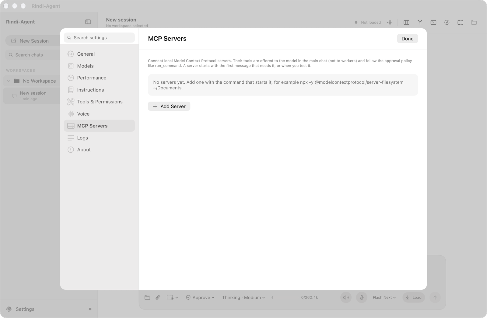

Rindi-Agent connects to [Model Context Protocol](https://modelcontextprotocol.io) servers over stdio:

1. In **Settings › MCP Servers**, click **Add Server**.
2. Enter the command that starts it, its arguments and any environment variables. For example: `npx -y @modelcontextprotocol/server-filesystem ~/Documents`.
3. Click **Test**. Rindi-Agent starts the server, lists its tools, and estimates how many tokens their descriptions add to each prompt.

MCP tools are offered in the main chat (not to worker agents) and follow the same approval policy as commands. A server that speaks HTTP can be connected through a stdio proxy such as `mcp-proxy`.

---

## 9. Keyboard shortcuts and slash commands

| Action | Shortcut |
| --- | --- |
| New session | ⌘N |
| Open workspace | ⌘O |
| Settings | ⌘, |
| Find chats | ⇧⌘F |
| Show or hide the sidebar | ⌃⌘S |
| Files, Source Control, Terminal, Browser, Board | ⌥⌘1 to ⌥⌘5 |
| Stop generating | ⌘. |
| Export chat | ⇧⌘E |
| Send / new line | Return / Shift-Return |
| Cycle thinking effort | Shift-Tab |

| Command | What it does |
| --- | --- |
| `/help` | Lists commands and shortcuts |
| `/new` (or `/clear`) | Starts a new session |
| `/compact` | Summarises older turns to free up context |
| `/mode plan`, `/mode approve`, `/mode turbo` | Switches the agent mode |
| `/thinking low`, `/thinking medium`, `/thinking xhigh` | Sets thinking effort |
| `/model` | Shows or switches the model |
| `/skills` | Lists skills and opens the skills folder |
| `/afm <prompt>` | Answers one message with Apple's on-device model |

---

## 10. Where your data lives

| Location | Contents |
| --- | --- |
| `~/Library/Application Support/Rindi-Agent` | Settings, workspaces, chats and boards; downloaded models by default |
| `~/Library/Caches/Rindi-Agent/PromptCache` | Saved conversation caches (size set in Settings › Performance) |
| `~/Library/Logs/Rindi-Agent/runtime.log` | Runtime log |
| `~/.rindi` | Global instructions and skills |

### Uninstall

1. Quit Rindi-Agent and drag it from Applications to the Trash.
2. To remove your data as well, delete the four locations above. The first one includes downloaded models, which can be very large.
3. To remove its macOS permissions, including those of the Computer Use helper, run:

   ```bash
   tccutil reset All com.rindi.agent; tccutil reset All com.rindi.agent.computer-use
   ```

---

## 11. Troubleshooting

**The first reply takes a long time.** The model is loading into memory. To load it in advance, click **Load** in the composer. Later replies start much faster, and switching between recent chats doesn't reprocess them.

**"Not enough memory", or the Mac slows down badly.** The model needs the memory listed in [section 1](#choose-a-model). Close other memory-heavy apps, or use the 27B model. **Unload** in the composer frees the model's memory without quitting.

**A download stopped.** Open **Model Setup** and click **Download** again. It resumes where it left off.

**Computer Use can see windows but can't click or type.** Turn on **Settings › Tools & Permissions › Native app control**, and check that Rindi-Agent is enabled under **System Settings › Privacy & Security › Device Control and Data Access**.

**Computer Use says Screen Recording is missing.** Enable Rindi-Agent under **System Settings › Privacy & Security › Screen Recording**. If the message names *Rindi Computer Use*, click **Reveal Rindi Computer Use** in the Computer Use window and drag the helper into that list. Quit and reopen Rindi-Agent afterwards.

**A command fails with a sandbox error.** By default, commands can write only inside the workspace. If the task really needs more, change **Workspace sandbox** in **Settings › Tools & Permissions**.

**Something else went wrong.** Open an [issue](https://github.com/True2456/Rindi-Agent-releases/issues) and include the runtime log (**Settings › About › Runtime log › Reveal**). Check the log for anything private first: it can include file names from your projects.
